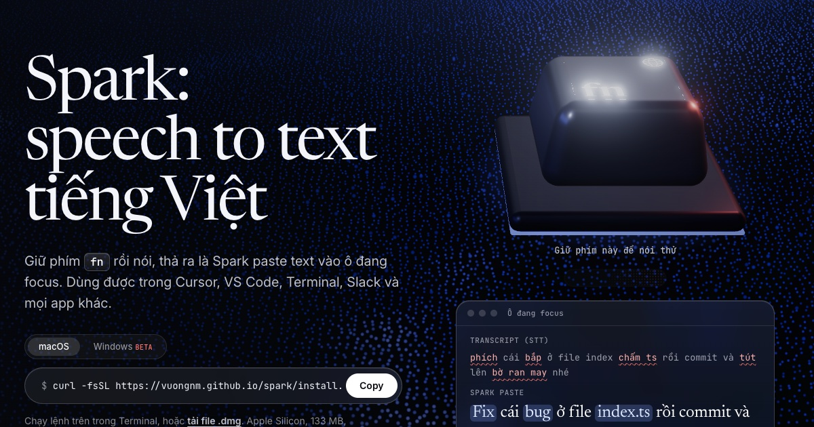
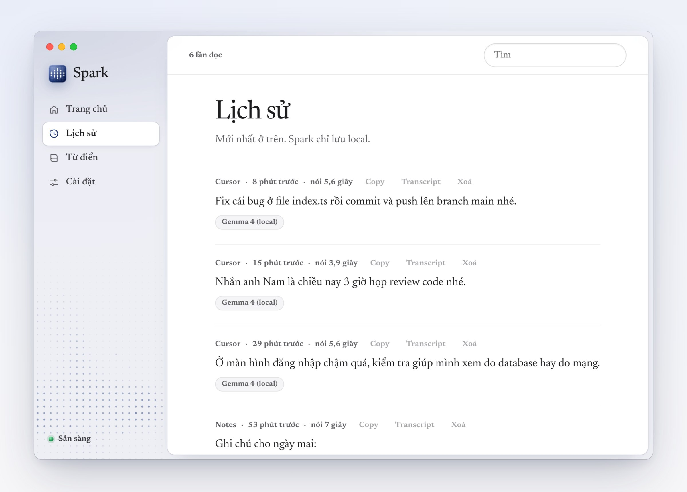
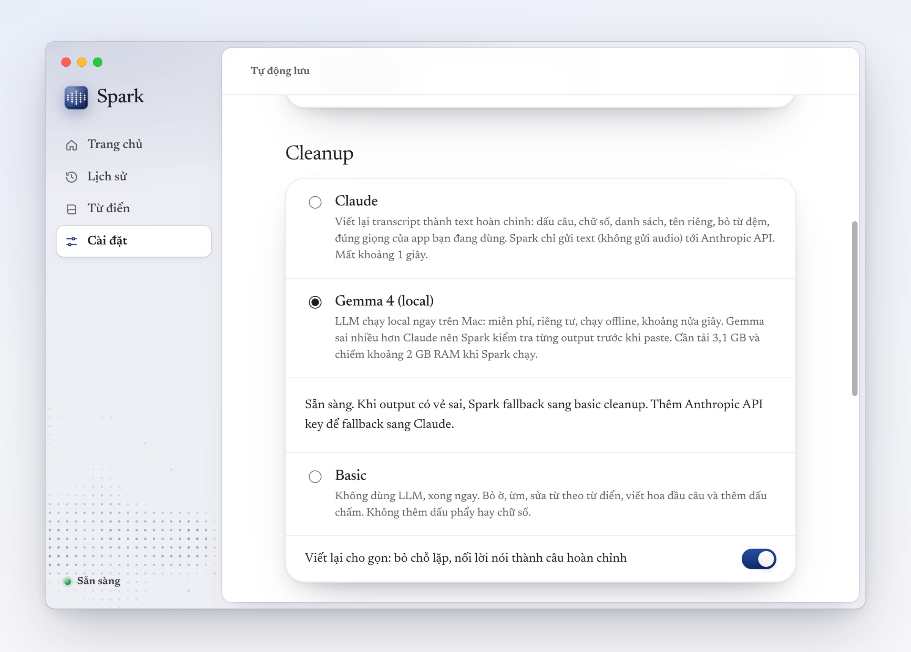
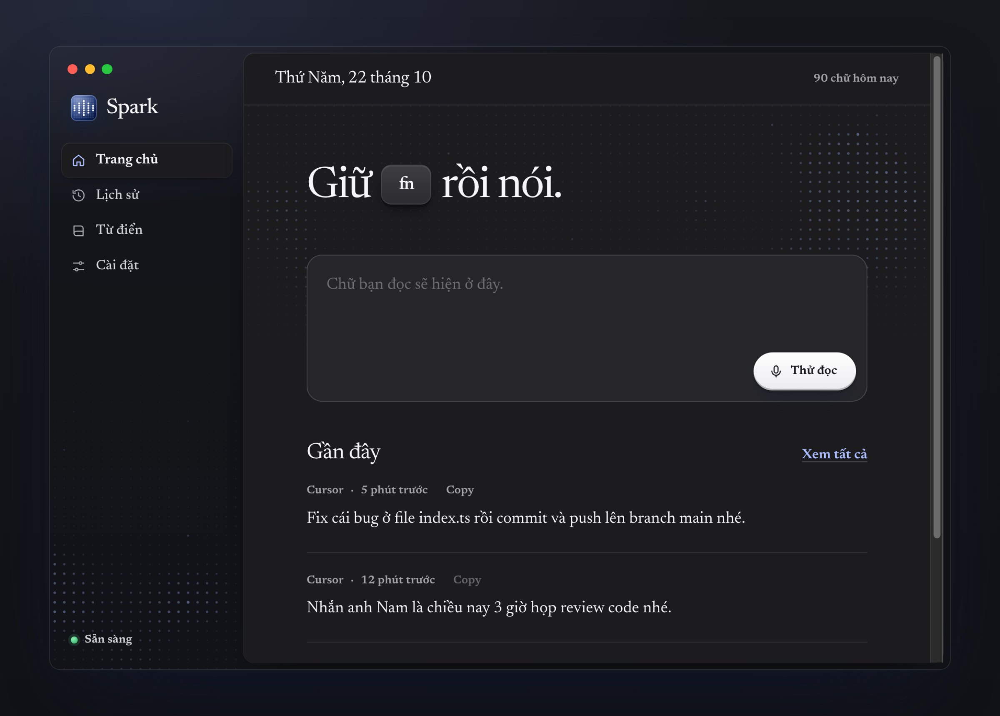

Mình vừa làm xong [Spark](/spark/), một app speech-to-text cho Mac. Giữ phím fn, nói tiếng Việt, thả ra là text được paste vào ô đang focus, trong Cursor, VS Code, Terminal hay Slack đều được.

Lúc làm việc mình hay nói nửa Việt nửa Anh, kiểu "report toàn bộ bằng tiếng Việt". Model speech-to-text tiếng Việt nghe những câu như vậy khá tệ, "report" thành "lừa đảo", "deploy" thành "đi phôi". Mình thích cách Wispr Flow cleanup text, nên tự làm một cái cho tiếng Việt, tập trung vào kiểu nói của dân code.

Phần speech-to-text chạy on-device. Mình dùng Zipformer tiếng Việt qua sherpa-onnx, 5 giây audio xử lý xong trong khoảng 0,1 giây trên CPU của con M1. Song song có thêm một model tiếng Anh nhỏ (Moonshine) để bắt các từ như commit, merge, database.



Sau đó một LLM viết lại transcript thành câu hoàn chỉnh. Bạn có thể dùng Gemma 4 chạy local (tải thêm 3,1 GB, không cần mạng), hoặc Claude nếu có API key, chính xác hơn và mất khoảng một giây. Spark so output với transcript gốc, nếu model tự thêm nội dung hay đổi số thì output đó bị loại.



Spark cũng làm được vài việc nhỏ khá tiện. Nói "ba giờ" thì ra "3 giờ", liệt kê vài việc thì ra bullet list, còn nói "index chấm ts" trong Cursor thì ra index.ts. Gemma đôi khi vẫn sai khi tiếng Anh phát âm quá Việt, Claude thì ổn hơn.



App viết bằng Electron, React và TypeScript, source code để trên [GitHub](https://github.com/VuongNM/spark). Hiện Spark chạy trên Mac Apple Silicon, bản Windows có rồi nhưng chưa test kỹ.

Cài bằng lệnh này trong Terminal:

```bash
curl -fsSL https://vuongnm.github.io/spark/install.sh | bash
```

Hướng dẫn đầy đủ ở [trang Spark](/spark/).
